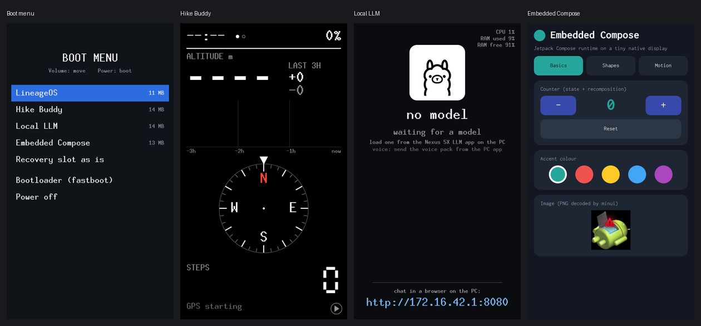

# nexus5x-bootmenu

A GRUB-style boot menu for the **Nexus 5X** (bullhead). Every power-on shows the
boot images stored on the phone. Pick one with the volume keys and Power. No PC
needed after a one-time install.

<p align="center"></p>

<sub>Recorded on QEMU with the phone's kernel source (see [QEMU](#try-it-in-qemu)): the menu, then each image after the menu switched to it.</sub>

| Entry | Project |
|---|---|
| LineageOS | [LineageOS 15.1](https://wiki.lineageos.org/devices/bullhead/), the phone's own `boot.img` |
| Hike Buddy | [nexus5x-hike-buddy](https://github.com/kaiwalyakhasnis/nexus5x-hike-buddy): a hiking console without Android |
| Local LLM | [nexus5x-local-llm](https://github.com/kaiwalyakhasnis/nexus5x-local-llm): llama.cpp on the bare phone |
| Embedded Compose | [embedded-compose](https://github.com/kaiwalyakhasnis/embedded-compose): Jetpack Compose runtime on fbdev |
| TWRP | [TWRP](https://twrp.me/lg/lgnexus5x.html), kept so zips can still be flashed |

Any boot image works: copy it to `/cache/bootmenu/` as `<order>-<Label>.img`
(`2-Hike_Buddy.img` shows as "Hike Buddy").

## How it works

The bootloader is signed and can't be replaced, but it boots two partitions:
`boot` normally, and `recovery` when the kernel reboots with the reason
`recovery`. So:

```
power on ─▶ aboot ─▶ boot partition: the MENU (LineageOS kernel + menu as /init)
                       │ pick an image from /cache/bootmenu/
                       │ write it into the recovery partition (skipped if already there)
                       │ reboot "recovery"
                       ▼
             aboot ─▶ recovery partition: the chosen image
```

- The next power-on shows the menu again. The last choice is highlighted and
  boots after 5 s.
- `/cache` holds the images because it is the phone's only unencrypted ext4
  partition (96 MiB). The menu mounts it read-only.
- **The menu writes only `recovery`**. It finds the partition by its GPT name,
  writes only valid boot images that fit, and reads the result back before
  rebooting. The QEMU tests check that every other partition stays byte-identical.
- The menu ([`menu/bootmenu.cpp`](menu/bootmenu.cpp)) is one static binary
  running as PID 1, drawing with AOSP's minui (fbdev). The bullhead kernel has
  no devtmpfs, so the menu builds `/dev` from sysfs.

## Build

Clone the image projects next to this one and build their boot images. Then:

```sh
cp local.env.example local.env   # set LINEAGE: a LineageOS 15.1 tree with bullhead built
scripts/build.sh                 # out/bootmenu-boot.img: LineageOS kernel + the menu
scripts/collect-images.sh        # out/images/: the entries, for QEMU
scripts/package.sh               # out/phone/: install.sh, uninstall.sh, menu, images
```

## Install on the phone

Needs an unlocked bootloader, root over adb, and TWRP in `recovery`:

```sh
adb root
adb push out/phone /sdcard/bootmenu-install
adb shell sh /sdcard/bootmenu-install/install.sh
adb reboot
```

`install.sh` first backs up `boot` and `recovery` to `/sdcard/bootmenu-backup/`.
It takes LineageOS from the phone's `boot` partition (so it matches the
installed system) and TWRP from `recovery`, copies all images to `/cache`, and
only then writes the menu into `boot`. `uninstall.sh` puts everything back.

- **Leaving an image:** hold Power for ~10 s, or reboot it. The menu comes back.
- **After flashing a LineageOS zip** (it replaces `boot`), or after TWRP's
  "Wipe cache", run `install.sh` again.
- **"Reboot to recovery" from Android** boots whatever is in the slot. Pick TWRP
  in the menu instead.
- **If the menu doesn't show up:** Volume Down + Power → bootloader → Recovery
  mode boots the slot as it is. Then run `uninstall.sh` from Android.

## Try it in QEMU

Uses the QEMU kit of
[nexus5x-recovery-roadfighter](https://github.com/kaiwalyakhasnis/nexus5x-recovery-roadfighter)
(the same LineageOS kernel source plus QEMU display and keyboard patches).

```sh
qemu/make-emmc.py      # virtual eMMC with bullhead's partitions
qemu/fake-aboot.py     # window: arrows + Enter; Ctrl-C = hold Power, twice = quit
qemu/make-emmc.py --test-images && qemu/test-switch.py   # every switch, refusals, untouched partitions
qemu/test-install.py   # install.sh, the menu, uninstall.sh
```

`fake-aboot.py` plays the bootloader. It boots `boot` or `recovery` from the
virtual eMMC depending on the reboot reason, which it reads from the kernel log
(the phone keeps it in the PMIC, which QEMU doesn't have). Each image's own
ramdisk runs on the QEMU build of the LineageOS kernel.

## Using it on other phones

The approach works on a phone whose unlocked bootloader:

1. boots a `recovery` partition when the kernel reboots with the reason
   `recovery` (most non-A/B phones, such as Qualcomm devices with LK/aboot), and
2. boots unsigned images from both partitions.

You also need an unencrypted partition with room for the images, and a kernel
with fbdev and initramfs support.

To port it, change:

| What | Where |
|---|---|
| Kernel, command line, base and offsets (from the device's `BoardConfig.mk`) | `scripts/build.sh` |
| Partition names, the image directory, the allowed slot size | constants at the top of `menu/bootmenu.cpp` |
| The `by-name` path and the device check | `phone/install.sh`, `phone/uninstall.sh` |
| Key codes (default: volume keys and Power, or arrows and Enter) | `main()` in `menu/bootmenu.cpp` |
| Partition sizes, for the QEMU tests | `LAYOUT` in `qemu/make-emmc.py` |

DRM-only kernels need minui's DRM backend (`graphics_drm.cpp` in AOSP). A/B
phones have no `recovery` partition: there, the menu would write the other
slot's `boot` and switch the active slot instead.

## Layout

| Path | What |
|---|---|
| `menu/` | the menu, with minui (from AOSP, via nexus5x-hike-buddy) |
| `scripts/` | build, collect images, package, `mkbootimg.py` |
| `phone/` | `install.sh`, `uninstall.sh`, run on the phone as root |
| `qemu/` | virtual eMMC, fake bootloader, keys and screenshots, tests |

minui is AOSP code under the Apache License 2.0.
